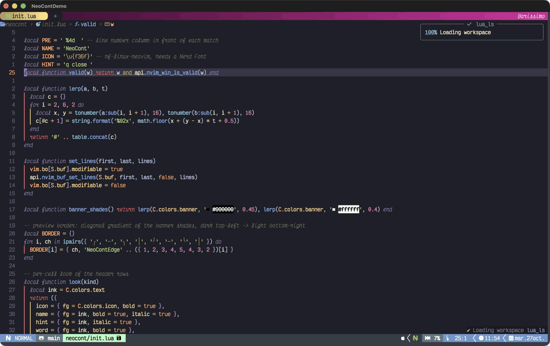
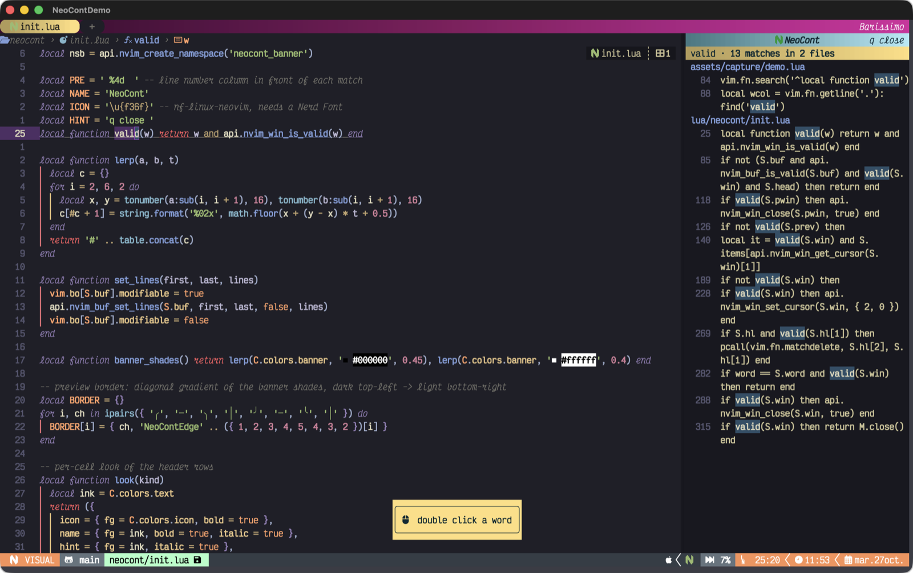
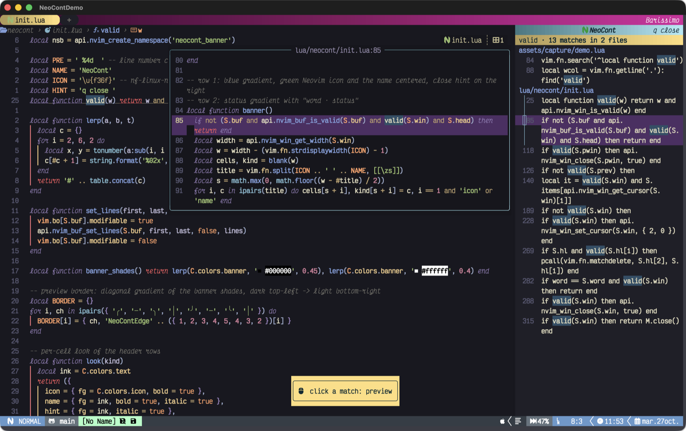
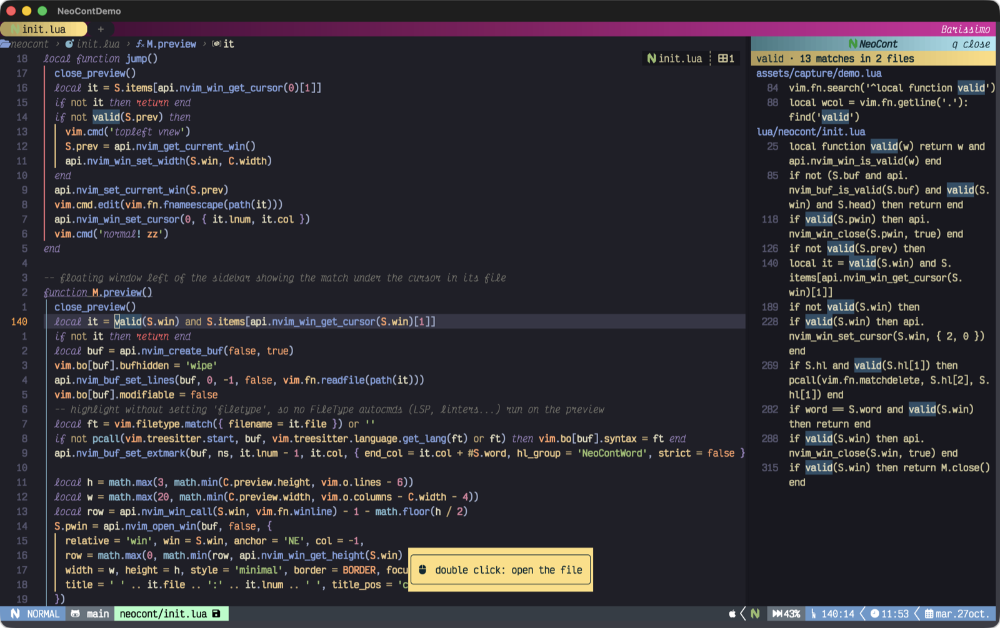

<p align="center">
  
</p>

# NeoCont

Find every occurrence of a word in your project from a sidebar, by double clicking on it.



## Features

- Double click on a word: it gets selected and a sidebar on the right lists every match in the project, grouped by file.
- Single click on a match: a popup previews the file at that line, with syntax highlighting.
- Double click (or `Enter`) on a match: opens the file at that line.
- Whole-word, case-sensitive search from the git root of the current file (or the current directory), using [ripgrep](https://github.com/BurntSushi/ripgrep) when available and `grep` otherwise. Searches run in the background, so Neovim never blocks.
- Gradient header with the Neovim icon, a status row with the number of matches, and a gradient border on the preview. Every color is configurable.

## Screenshots

| Double click a word | Click a match to preview it | Double click to open it |
|---|---|---|
|  |  |  |

## Requirements

- Neovim 0.11 or newer.
- `rg` (recommended) or `grep` in your `PATH`.
- Mouse support in normal mode (Neovim's default `mouse=nvi` works).
- A [Nerd Font](https://www.nerdfonts.com/) for the header icon.

## Installation

No need to call `setup()`: the plugin activates itself when Neovim starts.

### lazy.nvim

```lua
{ 'Gogiu23/NeoCont', lazy = false }
```

### vim.pack (Neovim 0.12+)

```lua
vim.pack.add({ 'https://github.com/Gogiu23/NeoCont' })
```

### packer.nvim

```lua
use 'Gogiu23/NeoCont'
```

### Without a plugin manager

```sh
git clone https://github.com/Gogiu23/NeoCont \
  ~/.local/share/nvim/site/pack/plugins/start/neocont
```

Restart Neovim and double click on any word. To check it's loaded, `:lua print(vim.g.loaded_neocont)` should print `true`.

## Configuration

NeoCont works without calling `setup()`. To change the defaults:

```lua
require('neocont').setup({
  width = 45,   -- sidebar width, in columns
  max = 1000,   -- maximum number of matches shown
  mouse = true, -- double click on a word searches it; false to only use :NeoCont
  preview = {
    width = 90,  -- maximum preview popup size (it shrinks to fit the editor)
    height = 15,
  },
  colors = {
    banner = '#74DBEF', -- title row background and preview border, from a dark to a light shade of it
    status = '#FFDE7D', -- status row background, from 70% to 100% of it
    icon = '#019833',   -- Neovim icon
    text = '#0b2a33',   -- text on both header rows
  },
})
```

With lazy.nvim, pass the same table as `opts`:

```lua
{
  'Gogiu23/NeoCont',
  lazy = false,
  opts = {
    width = 50,
    colors = { banner = '#2391FF', status = '#B4F8C8' },
  },
}
```

You only need to set what you want to change; nested tables (`preview`, `colors`) are merged with the defaults. Colors must be `#rrggbb` hex strings.

### Highlight groups

The match colors follow your colorscheme through these groups, which you can override:

| Group | Default link | Used for |
|---|---|---|
| `NeoContWord` | `Search` | The searched word, in the file, the sidebar and the preview |
| `NeoContFile` | `Directory` | File names in the sidebar |
| `NeoContLnum` | `LineNr` | Line numbers in the sidebar |

```lua
vim.api.nvim_set_hl(0, 'NeoContWord', { fg = '#000000', bg = '#FFDE7D', bold = true })
```

## Usage

| Where | Action | Result |
|---|---|---|
| Any file | Double click on a word | Select it and list its matches in the sidebar |
| Sidebar | Click on a match | Preview the file at that line in a popup |
| Sidebar | Double click / `Enter` on a match | Open the file at that line |
| Sidebar | `q` | Close the sidebar |

### Commands

| Command | Action |
|---|---|
| `:NeoCont` | Toggle the sidebar with the word under the cursor |
| `:NeoCont <word>` | Search `<word>` |
| `:NeoContClose` | Close the sidebar |

To use it from the keyboard, map the command, e.g.:

```lua
vim.keymap.set('n', '<leader>n', '<Cmd>NeoCont<CR>', { desc = 'NeoCont' })
```

### Lua API

```lua
require('neocont').search('word') -- search a word
require('neocont').lookup()       -- search the word under the cursor (in the sidebar: open the match)
require('neocont').preview()      -- preview the match under the sidebar cursor
require('neocont').close()        -- close the sidebar
```

## Notes

- Matches are whole words and case-sensitive: searching `foo` doesn't list `foobar` or `Foo`.
- ripgrep honors your `.gitignore`; the `grep` fallback only skips `.git` and binary files.
- Indentation is stripped in the sidebar so long lines stay readable; they wrap under the text.
- A double click starts with a single click, so the preview flashes for a moment before the file opens.

## Development

```sh
# headless tests
nvim --headless -u NONE --cmd 'set rtp+=.' -l tests/smoke.lua

# regenerate the screenshots and assets/demo.gif in a new Alacritty window
# (macOS, needs ffmpeg; the terminal running it needs Screen Recording permission)
assets/capture/run.sh
```
